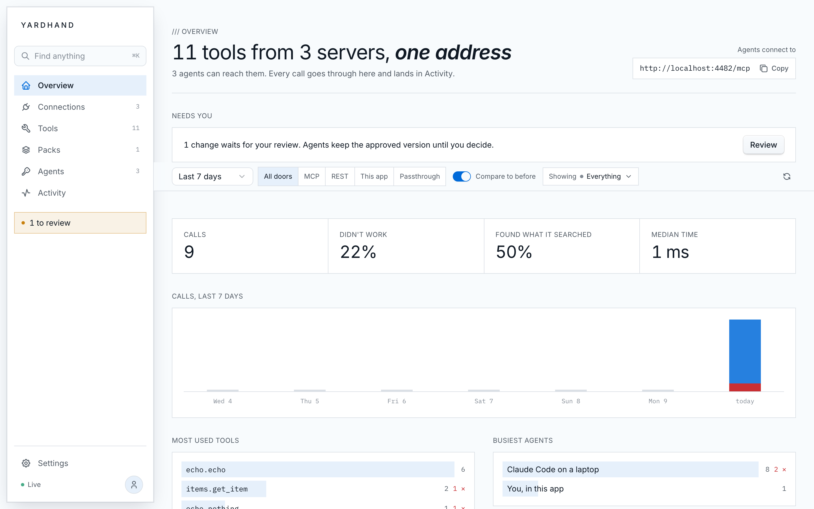

<p align="center">
  
</p>

<h1 align="center">Yardhand</h1>

<p align="center">
  A self-hosted gateway for AI agents: connect a server once, and every agent you allow can use its tools,
  over MCP or REST, with the keys kept in one place and every call on the record.
</p>

<p align="center">
  <a href="https://github.com/escalay/yardhand/actions/workflows/ci.yml"></a>
  <a href="https://github.com/escalay/yardhand/releases"></a>
  <a href="https://securityscorecards.dev/viewer/?uri=github.com/escalay/yardhand"></a>
  <a href="LICENSE"></a>
</p>

## Why

Every agent you run, whether Claude Code, Cursor, Codex, claude.ai or your own scripts, wants the same tools, and
each one wants them configured again, with the keys pasted again. Yardhand sits in front of your MCP servers and
REST APIs and gives every agent one address instead.

- **One address, every tool.** Agents search for a tool by what they want to do, read its schema and run it. Hundreds
  of tools cost an agent a handful of tokens until it needs one.
- **Keys stay put.** Each server's credentials are stored once, sealed with AES-GCM. Agents get keys of their own,
  each reaching only what you choose, read-only or not, and revocable on their own.
- **You decide what runs.** Switch a tool, a group of tools or everything that deletes off. A third-party server that
  changes a tool's description waits for your review before agents see it.
- **Everything on the record.** Every call, by which agent, with what result and how long it took, live in the app
  and optionally traced to Langfuse.
- **Packs.** Hand an agent a curated kit for one kind of work, in your own wording, with a key that expires.
- **Yours to run.** One container, SQLite, daily backups, restore in two clicks, and no telemetry.

## Run it

```sh
mkdir yardhand && cd yardhand
curl -fsSLO https://github.com/escalay/yardhand/releases/latest/download/docker-compose.yml
docker compose up -d
docker compose logs gateway        # the setup code
open http://localhost:8080/app     # claim it, then a guided setup connects your first server and agent
```

No settings are needed to start. [Self-hosting](deploy/compose/README.md) covers HTTPS, your own network, backups,
updates and every setting.

On a platform, with a disk for the data:

[](https://render.com/deploy?repo=https://github.com/escalay/yardhand)

```sh
fly launch --from https://github.com/escalay/yardhand --copy-config --ha=false   # Fly.io; then set PUBLIC_HOST as fly.toml says
```

The setup code is in the service's logs on both.

On a new server it is one paste: give [`deploy/cloud-init.yaml`](deploy/cloud-init.yaml) as the user data when you
create an Ubuntu or Debian server at any provider, and Yardhand is running when it boots.

## Connect an agent

The app writes the setup for each agent, key included. For Claude Code it is one line:

```sh
claude mcp add --transport http --scope user gw https://your-yardhand.example/mcp \
  --header "Authorization: Bearer <key>"
```

Scripts use REST: `GET /api/tools?q=…` to find a tool, `POST /api/calls` to run it, or the typed client in
[`packages/client`](packages/client). The API is described at `/docs`, and agents read `/llms.txt`.

## How it fits together

```
agents ──MCP /mcp──┐                       ┌── MCP servers
scripts ──REST /api─┤  Yardhand          ├── REST APIs (OpenAPI)
claude.ai ──OAuth───┘  search · keys ·     └── Composio apps
                       switches · reviews ·
                       log · packs
```

[docs/architecture.md](docs/architecture.md) has the pipeline every call goes through, with diagrams.

## Develop

Node 26 and pnpm (`corepack enable`).

```sh
pnpm install
pnpm demo        # a gateway with fake servers and the app on http://localhost:4400/app
pnpm gate        # lint, types and tests
pnpm e2e         # browser tests
```

[CONTRIBUTING.md](CONTRIBUTING.md) explains how changes land and how releases are cut. Security issues go through
[SECURITY.md](SECURITY.md), never a public issue.

## License

[AGPL-3.0](LICENSE). Run it, change it and self-host it freely; if you offer a modified Yardhand to others as a
service, share your changes under the same license. Illustrations are [Open Doodles](https://www.opendoodles.com/)
(CC0) and the typeface is [Inter](https://rsms.me/inter/) (OFL).
