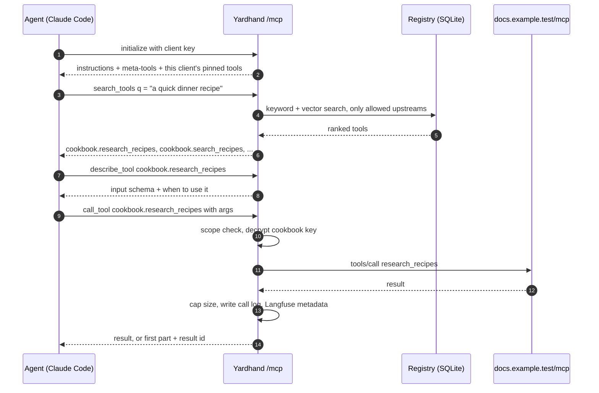
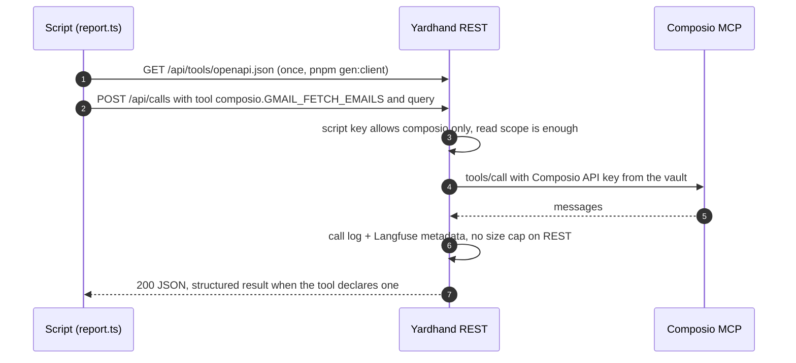
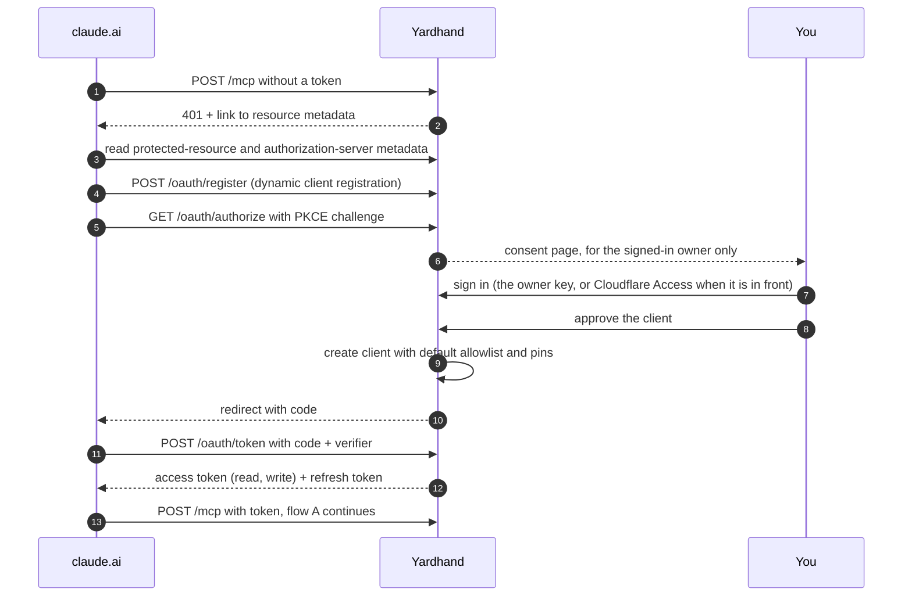
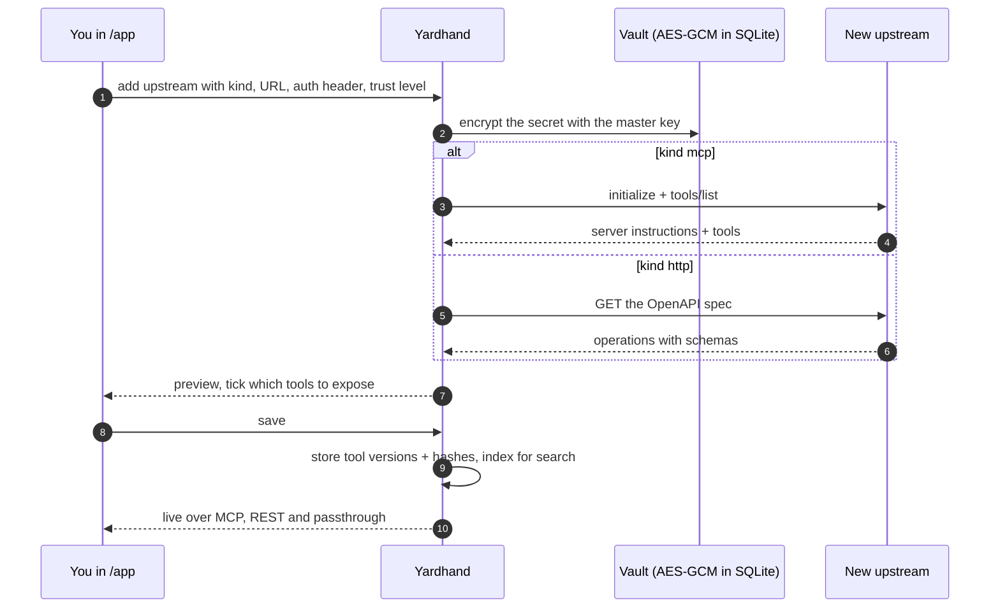
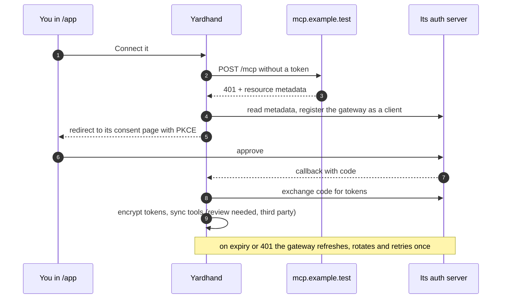
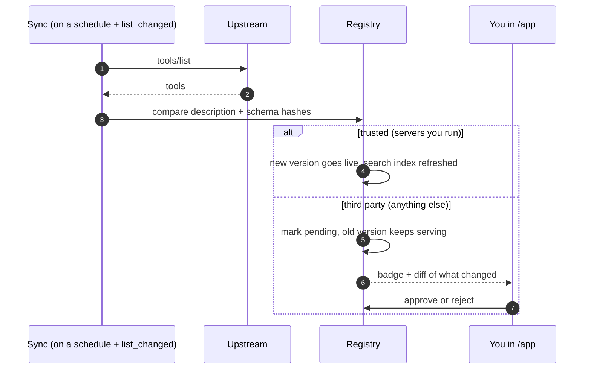
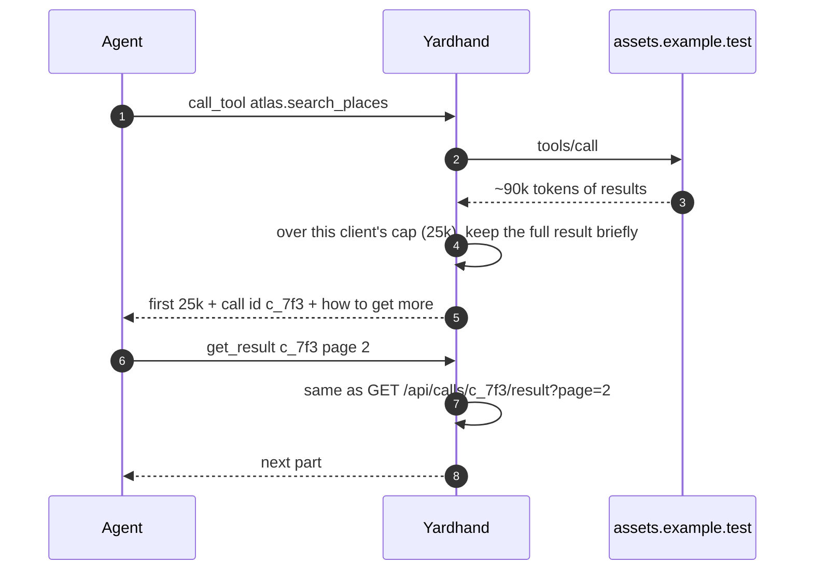
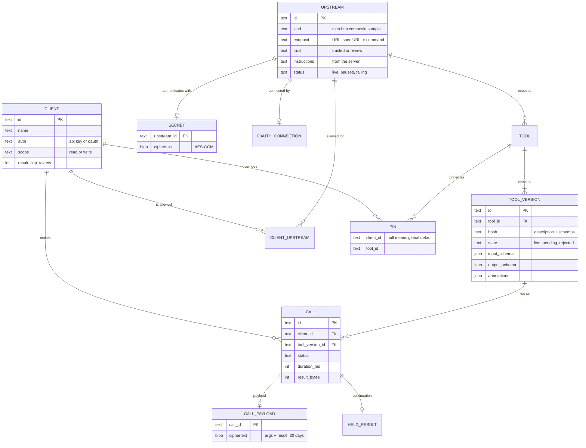

# Architecture

Layers, top to bottom: **clients** → **front doors** (`/mcp`; REST under `/api` with runs at `POST /api/calls` and the tools as OpenAPI at `/api/tools/openapi.json`; passthrough `/u/{upstream}/mcp`; link proxy `/u/{upstream}/r/*`; `/oauth/*`; `/app` behind the owner's sign-in) → **core** pipeline → **adapters** (`mcp`, `http`, `composio`, `sample`) → **upstreams**. State beside the core: SQLite (registry, clients, pins, call log), the AES-GCM vault, the master key in `instance.json` or the environment, the meaning-search ledger, nightly snapshots in `/state/backups`.

## Call pipeline

authenticate → allowlist → scope (write tools need write) → resolve (live version) → arguments checked against the schema (defaults filled) → credential (key, or OAuth token refreshed by the SDK) → adapter call (one retry for reads on a stale connection) → links rewritten to the proxy → cap (MCP only, per client) → audit (call row, sealed payload 30 days, Langfuse metadata when configured).

## Flows

### A. An agent finds a tool and calls it

Claude Code connects once, searches across all upstreams and calls cookbook. Most calls take this path.

### B. A script calls the same tool over REST

No MCP client in the script: one HTTP call, or the typed client generated from /api/tools/openapi.json.

### C. claude.ai connects for the first time

The kit's OAuth server; you approve as the signed-in owner; the new client starts with the default allowlist.

### D. You add a new upstream in the UI

Adding a server: an MCP URL or an OpenAPI spec, a key, a trust level. Live in about a minute.

### E. You connect an OAuth upstream

This time the gateway is the OAuth client: discover, register, consent, store tokens, refresh them silently.

### F. An upstream changes its tools

Your own upstreams go live on sync. Third-party changes wait for your review, so a quietly rewritten tool description can't slip injected instructions past you.

### G. A result is too big for the agent

The gateway returns the first part and a handle; the agent pages only if it needs more.

## Data model

