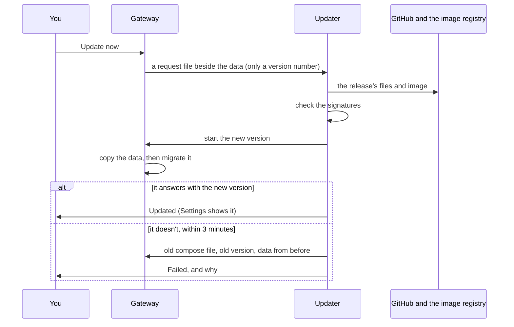

# Updates

Yardhand tells you when a newer version is out and, on a Docker Compose install, moves to it when you say so. A
failed update puts the old version and your data back by itself.

## In short

| Question | Answer |
|---|---|
| How does it know? | Once a day it asks for the newest version number. One plain request: no id, no report, and it works with telemetry off |
| Where do I see it? | Settings › Updates, and a line on the overview. Each version links to its release notes |
| Does it update by itself? | No, unless you switch on "Update automatically" |
| What does "Update now" do? | The updater beside the gateway verifies the release, starts it, and rolls back if it doesn't come up |
| What if it goes wrong? | The old version, the old compose file and the data from before the update are put back. Settings says why |
| How do I switch it off? | The check: Settings › Updates, or `GATEWAY_UPDATE_CHECK=off`. The updater: `GATEWAY_UPDATER=0` |

## What happens when you choose Update now



1. **The gateway writes a request.** It has no access to Docker and never updates itself. The request carries a
   version number and nothing else.
2. **The updater checks the release.** It downloads `release.json` from that release on GitHub and verifies that
   Yardhand's release workflow signed it. That file names the image by its digest and the compose file by its hash,
   so nothing else can be installed under that version number. The image's own signature is checked too.
3. **It starts the new version** from the release's compose file. Your `.env` isn't touched.
4. **The new version copies the data** to `backups/before-<version>.sqlite` before it migrates anything.
5. **The updater waits** up to three minutes for the gateway to answer as healthy with the new version.
6. **Otherwise it rolls back:** the old compose file, the old version, and the copy from step 4. Anything written
   between the start of the update and the rollback is lost; the gateway is down for most of that time.

A request is refused, with nothing changed, when the version isn't newer, the release isn't signed, or the release
says this version is too old to move to it in one step. Settings then names the version to update to first.

## What the updater is, and what it may do

The updater is a second container in the compose file (`ghcr.io/escalay/updater`, source at
[escalay/selfhost-kit](https://github.com/escalay/selfhost-kit)). It is a short shell script around Docker Compose
and cosign.

**It holds the Docker socket, which is as good as root on the machine.** That is what starting and replacing
containers takes. The gateway itself holds no such access: it stays read-only, without capabilities, and can only
leave a version number where the updater looks. Where the releases come from and who must have signed them are fixed
in the updater's own settings, so a request can't point it anywhere else.

To run without it, put `GATEWAY_UPDATER=0` in `.env` and run `docker compose up -d`. Settings then shows the
commands to update by hand.

## Settings

Everything lives in `.env` beside the compose file. The updater starts the new version from that folder, so a
setting given only in your shell when you first ran `docker compose up` is not there at the next update.

| Setting | What |
|---|---|
| `GATEWAY_UPDATE_CHECK` | `off` starts with the daily check off. A starting value: Settings › Updates changes it afterwards |
| `GATEWAY_AUTO_UPDATE` | `on` starts with automatic updates on. A starting value too |
| `GATEWAY_UPDATER` | `0` removes the updater container |
| `GATEWAY_UPDATE_URL` | Where the newest version is asked; answer `{"latest":"1.2.3"}` from a server of your own for a fork or a fleet |
| `GATEWAY_UPDATE_HOOK` | Where no updater runs: a deploy hook of your platform, called when you choose Update now |
| `GATEWAY_UPDATE_HOOK_TOKEN` | Sent with the hook as a bearer token, when the platform wants one |

Your own additions belong in `docker-compose.override.yml`, never in `docker-compose.yml`: each update replaces
the second with the release's and keeps the first.

## By install

| Install | How it updates |
|---|---|
| Docker Compose, and a server started from `deploy/cloud-init.yaml` | The updater, from Settings |
| A platform that redeploys on a hook (Render and the like) | Set `GATEWAY_UPDATE_HOOK`; the platform must follow the `latest` image tag |
| Anything else | By hand, below |

## By hand

```sh
curl -fsSL -o docker-compose.yml https://github.com/escalay/yardhand/releases/latest/download/docker-compose.yml
docker compose pull && docker compose up -d
```

The data is copied before the new version migrates it either way. To go back, restore
`before-<version>.sqlite` in Settings › Backups and pin the older version with `GATEWAY_IMAGE`.

**Coming from 0.2.0 or earlier:** those versions have no updater, so this first move is by hand. From then on
Settings does it.

## What every release promises

- Migrations only go forward, and a step that shipped never changes.
- The data is copied before every upgrade.
- Each release names the oldest version that can move to it in one step (`upgradeFrom` in its `release.json`).
- Setting names don't change; a replaced one keeps working for a release.
- Every change is run through real updates before it merges (`scripts/smoke-upgrade.sh`): the last release with
  data in it is updated to the new build, then an update is asked for in the app, then one that fails is rolled back.

## For agents and scripts

Everything Settings does is on the owner API: `GET /api/system/updates` (the version, the newest, the updater, the
last run and the history), `POST /api/system/updates/check`, `PATCH /api/system/updates` for the two switches, and
`POST /api/system/updates/requests` to ask for an update.
